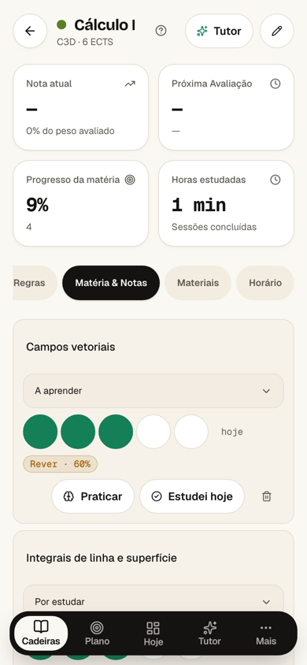
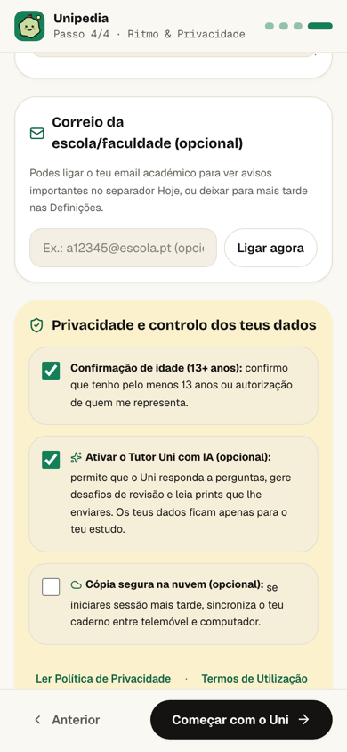
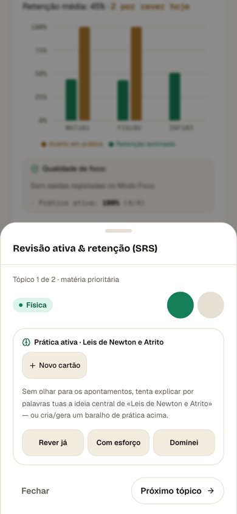
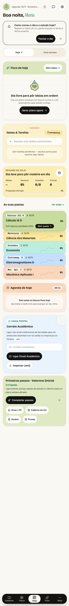
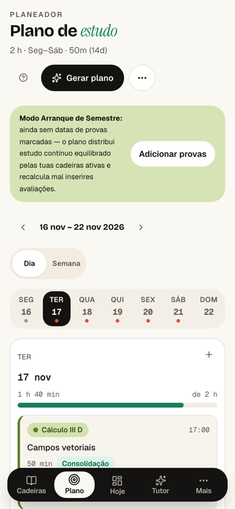
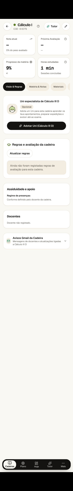
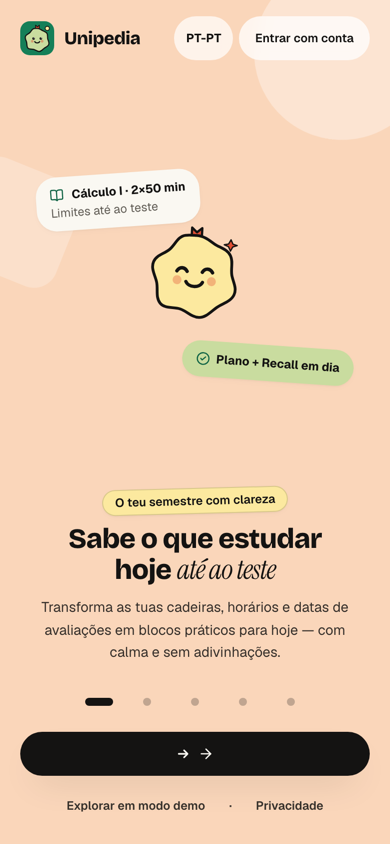
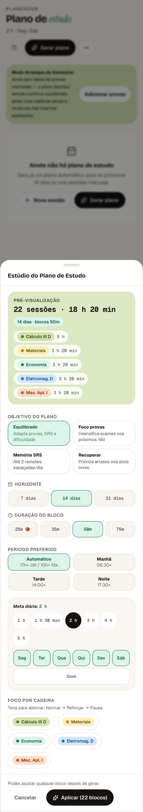
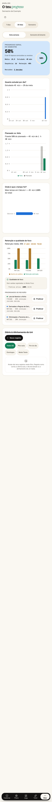

# Auditoria da Unipedia — novembro de 2026

**Data:** 16 de novembro de 2026 · **Base:** `main` em `0a1daf9` · **Fase 1 de 4 (sem código)**

## Como foi feita

- **Percurso real** a 390 × 844 px, em pt-PT, como estudante novo (modo «só neste telemóvel»): boas-vindas → entrar → onboarding (NOVA FCT, Eng. Mecânica, 2.º ano) → Hoje → gerar plano → sessão de foco → recall → pasta da cadeira → Tutor → progresso. Repetido com os dados de demonstração (`?demo=1`) e em tema escuro. Guiado por Playwright, com capturas em `docs/revisao/img/`.
- **Quatro auditorias de código em paralelo** (criador de plano, Tutor/IA, design system + acessibilidade + i18n, dívida técnica). A do planeador correu o `generatePlan` verdadeiro com cenários difíceis; os resultados marcados **[corrido]** foram observados, os **[lido]** foram deduzidos do código.
- `npm run check`, `npm run guard:ui`, `npm run i18n:report`, `npm run build` e `knip`.

## O que não consegui verificar

- **O Tutor a responder.** Em `localhost` o App Check devolve 403 e o Gemini 401, por isso o chat, o caderno com PDFs e a geração de cartões só foram auditados pelo código. Para a Fase 3 é preciso um *debug token* do App Check ou uma chave pessoal de teste.
- **Android nativo** (Escudo, notificações) e **sincronização com conta** (só usei o modo local).
- **Importação por foto** (precisa de IA) e **CLIP com HTML real** (não existe nenhum no repositório).
- Contraste das 6 paletas alternativas (só a «Caderno Vivo», clara e escura).

## Resumo em cinco linhas

1. O ciclo plano → foco → recall existe e está bem desenhado visualmente, mas **não arranca sozinho**: o onboarding deixa os testes para depois (de propósito), só que a app nunca volta a pedi-los e o caminho para os inserir está escondido. Sem testes, o plano é genérico.
2. O **planeador falha nos casos reais** de um estudante de engenharia: aulas à tarde/noite, três testes na mesma semana, matéria que não cabe. Não avisa quando o plano não chega.
3. O **Tutor ainda não é melhor do que o Gemini genérico**: envia os PDFs inteiros em cada mensagem, não tem método para exercícios de engenharia e as proteções do ADR-001 não estão feitas (nenhuma das três do piloto).
4. Há **três riscos sérios fora do ecrã**: `npm run check` está vermelho, os dados vivem numa única chave de `localStorage` com erros engolidos, e o consentimento de IA diz ao estudante uma coisa que o ADR-001 desmente.
5. O design system é bom na base (tokens, tipografia, modal nativo), mas **a regra não é aplicada**: ~290 cores escritas à mão, ~100 alvos abaixo de 44 px, texto coral abaixo do contraste AA.

---

## 1. Os 15 maiores problemas (por impacto no estudante)

Esforço: **S** até meio dia · **M** 1 a 3 dias · **L** uma semana ou mais.

### 1. Quando as datas dos testes saem, o sítio para as pôr está escondido — S a M

- **Onde:** `Planner.tsx:424` e `:473` (botão «Adicionar provas»); pasta da cadeira; `SmartScheduleImportModal.tsx` (modo `focus: 'assessments'`).
- **O que acontece:** o onboarding não pede testes, e bem: no início do semestre as datas ainda não existem (decisão do Pedro), e a foto do horário já cria cadeiras e aulas. O problema é o regresso. O plano fica em «Modo Arranque de Semestre» e o botão «Adicionar provas» leva à **lista de cadeiras**, sem mais indicação. O caminho manual é: abrir pasta → separador «Matéria & Notas» → descer abaixo dos tópicos → «Nova avaliação» (5 toques, e o nome do separador não sugere «testes»). A leitura de avaliações por foto **já existe**, mas só se abre a partir de «Primeiros passos», da importação em Cadeiras e do Calendário; o botão do Plano não a usa. Nada lembra o estudante de voltar quando as datas saem. 
- **Porque importa:** o objetivo da Fase 2 («5 cadeiras, testes em 4 semanas, plano em menos de 1 minuto») depende de os testes entrarem depressa. Sem datas, tudo o que o planeador sabe fazer bem fica desligado.
- **Proposta:** «Adicionar provas» abre uma folha «Os teus testes» com duas entradas: foto do calendário de avaliações (o leitor que já existe) e linha manual (cadeira, data, peso; repetível). A mesma folha abre no criador de plano quando não há testes. Um lembrete discreto no Hoje 2 a 3 semanas depois do arranque («Já tens as datas dos testes?»), que desaparece ao primeiro teste inserido.

### 2. O planeador não usa as horas livres reais — M

- **Onde:** `src/lib/planner.ts:357`, `:735-751`, `:89-90`, `:393`.
- **O que acontece [corrido]:** o cursor começa às 17:00 e só anda para a frente. Com aulas das 17:00 às 22:00, as sessões caem entre as 22:10 e as 23:30 e as manhãs nunca são usadas. Blocos que acabariam depois das 23:30 são **descartados em silêncio**, depois de já terem «gasto» o esforço do tópico. Com 5 cadeiras e aulas 9–13 e 14–18, a meta de 2 h deu em média 70 min por dia. O máximo de 4 blocos por dia torna inalcançáveis as metas de 4 h e 5 h (uma meta de 5 h gerou 140–155 min).
- **Porque importa:** o estudante vê um plano que não cabe na sua vida ou que promete menos do que pediu, e deixa de confiar.
- **Proposta:** calcular janelas livres por dia (aulas, eventos, atividades extra), preencher da manhã para a noite segundo o período preferido, nunca descartar um bloco sem o dizer, e deixar o número de blocos seguir a meta diária.

### 3. O plano não cobre a matéria nem avisa quando não chega — M

- **Onde:** `planner.ts:540-567` (pontuação), ciclo guloso de tópicos; pré-visualização em `PlanBuilderModal.tsx`.
- **O que acontece [corrido]:** dentro de uma cadeira o planeador escolhe sempre o mesmo tópico (o tópico 1 durante cinco dias seguidos); com um teste ao sábado e 4 tópicos, o 4.º nunca foi marcado. Numa semana com três testes, uma cadeira recebeu 70 min para ~600 min de necessidade, sem qualquer aviso. O peso da avaliação quase não pesa (teste de 20 % = 0,7; de 50 % = 1,0). A revisão 1→3→7 não existe dentro do plano: só entram tópicos já em atraso, e um tópico com intervalo de 1 dia recebeu um bloco SRS **todos os dias** durante 10 dias. A estratégia «Recuperar» é um botão sem efeito (`PlanBuilderModal.tsx:142`). O horizonte máximo é de 21 dias: um teste a 25 dias fica de fora.
- **Porque importa:** chegar ao teste sem ter visto um capítulo é o pior resultado possível para uma app de planeamento.
- **Proposta:** rodar tópicos por cobertura antes de aprofundar; por cada teste mostrar «necessário vs. marcado» e «tópicos cobertos»; avisar quando falta tempo e propor o que cortar; projetar as revisões 1→3→7 dentro do plano; horizonte até 28 dias; implementar ou retirar «Recuperar».

### 4. Falhar um dia: nada se ajusta sozinho e o reagendamento erra — M

- **Onde:** `planner.ts:782-891` (`rescheduleOverdueSessions`), `Planner.tsx:274-278`, `useStore.ts:255`.
- **O que acontece:** as sessões falhadas ficam num cartão «Em atraso» à espera de ação manual. **[corrido]** O reagendamento não olha para a data do teste: um teste na terça às 14:00 ficou com «Revisão para teste» na terça às 17:00 e na quarta. «Mover tudo para hoje» só muda a data, ignora a meta diária e mantém a hora antiga. **[lido]** Ao gerar de novo, o mesmo tópico é planeado outra vez em cima do atraso (carga a dobrar), e uma sessão reagendada continua marcada como gerada, por isso o próximo «Gerar plano» apaga-a.
- **Porque importa:** falhar um dia é o caso normal. Hoje gera culpa (cartão de atraso) e trabalho manual, e pode produzir um plano absurdo.
- **Proposta:** ao abrir a app com sessões por fazer, redistribuir sozinho dentro da meta e antes de cada teste, e mostrar uma linha neutra («Ontem ficaram 50 min por fazer; pus 25 min hoje e 25 min na quinta. Desfazer»). O que não couber antes do teste é dito, não escondido.

### 5. O Tutor envia os PDFs inteiros em cada mensagem e sem orçamento — S agora, L para a solução certa

- **Onde:** `useAssistantChat.ts:388-433`, `materialContent.ts:578`, `gemini.ts:99`, `:1375`.
- **O que acontece:** cada mensagem volta a anexar todos os PDFs fixados. No modo partilhado não há orçamento de tokens (só com chave pessoal); o limite é de 3 ficheiros e 14 MB. O tempo limite do modelo principal é de 10 s também para pedidos grandes, por isso um caderno pesado cai muitas vezes para o modelo mais fraco e põe o principal 2 minutos em pausa. Não existe extração local de texto: `pdfjs-dist` e MiniSearch não estão no projeto.
- **Porque importa:** respostas lentas e de pior qualidade exatamente quando o estudante dá mais contexto; a quota partilhada esgota-se depressa (ADR-001, força 3); e não há citação de página, que é o que distinguiria o Uni do Gemini genérico.
- **Proposta:** já (S): orçamento de 60 mil tokens no modo partilhado, PDFs só na primeira mensagem da conversa, tempo limite proporcional ao tamanho. Depois (L, Fase 3): índice local com `pdfjs-dist` + MiniSearch em IndexedDB e envio de excertos com «p. X».

### 6. Consentimento e proteções de IA não correspondem ao ADR-001 — S

- **Onde:** passo 4 do onboarding; `SmartScheduleImportModal.tsx:266`; `aiQuota.ts`; `gemini.ts:1203`.
- **O que acontece:** a caixa de IA diz «Os teus dados ficam apenas para o teu estudo», quando o ADR-001 reconhece que no nível gratuito a Google usa o conteúdo e pode haver revisão humana. Não há confirmação de 18 anos (só 13+; o próprio prompt diz «para qualquer idade (13+)»). Importar o horário por foto **liga o consentimento de IA em silêncio**. As quotas (15/3/8) vivem em `localStorage` e apagam-se com um clique; a contagem de uso fica só no dispositivo e ninguém a lê. 
- **Porque importa:** é o estudante que é enganado sobre para onde vão os seus apontamentos; e sem números de uso o piloto não responde à pergunta que o ADR lhe faz.
- **Proposta:** as ações 1 a 3 do ADR tal como estão escritas, corrigir o texto do consentimento, pedir consentimento explícito na importação por foto. Quotas no servidor só são possíveis de forma fiável com Cloud Functions (plano pago): **não implementar**; no Spark fica a contagem anónima no Firestore com regras que só deixam incrementar, que serve para medir mas não para travar abuso.

### 7. As quotas de IA gastam-se onde o estudante não vê — S

- **Onde:** `gemini.ts:2178` + `useAssistantChat.ts:540`; `gemini.ts:1444`; `:756`, `:1586`, `:1642`; `:671-675`; `:1451` e outros `JSON.parse`.
- **O que acontece:** o resumo de memória corre a cada mensagem e consome a quota de **recall** (8 por dia), com o erro engolido. Gerar cartões de prática consome a quota de **caderno** (3 por dia). Três chamadas de leitura de prints não contam para quota nenhuma. Carregar em «Parar» depois de a resposta chegar devolve a mensagem. Um JSON malformado dá erro cru e **não** devolve a quota. Erros 400 e 403 percorrem os 4 modelos com até 10 s cada.
- **Porque importa:** o estudante fica sem recalls a meio da tarde sem ter feito nenhum, e o erro que vê não explica porquê.
- **Proposta:** um balde por tipo de pedido visível ao estudante, tarefas internas fora das quotas visíveis mas contadas no total, devolução correta, 400/403 sem nova tentativa.

### 8. O recall de fim de bloco é fraco quando não há cartões — M

- **Onde:** `ActivePracticeDeck.tsx`, `uniTools.ts:549`.
- **O que acontece:** sem cartões (o caso de qualquer estudante novo, e de todos quando a IA falha), o recall é uma frase («tenta explicar por palavras tuas…») e três botões de autoavaliação, sem campo para responder nem nada para comparar. Dois círculos sem rótulo fazem de indicador de progresso. Se a página recarregar, o recall perde-se. Os cartões criados pelo Tutor empurram os mais antigos para fora ao 9.º, sem aviso. 
- **Porque importa:** o recall é a parte do ciclo com mais efeito na nota. Autoavaliação sem resposta escrita inflaciona o «Dominei» e alimenta o planeador com dados errados.
- **Proposta:** modo sem IA com resposta escrita (ou falada) e três perguntas-guia fixas por tipo de tópico (definir, aplicar, relacionar); criar cartão a partir da própria resposta; guardar o recall pendente; limite de cartões por tópico com ordenação por necessidade em vez de corte.

### 9. O primeiro «Hoje» não diz ao estudante o que fazer — M

- **Onde:** `Dashboard.tsx` (909 linhas, ~12 blocos).
- **O que acontece:** segundos depois do onboarding, o topo do ecrã pergunta «Como correu o dia e o estudo hoje? · Fechar o dia». Seguem-se 9 secções, incluindo «Correio Académico» e «Primeiros passos · Veterano (Início) · 0/4 ligadas» (rótulo interno). «Gerar plano agora» só navega para o Plano, onde é preciso carregar outra vez em «Gerar plano» e depois em «Aplicar». 
- **Porque importa:** o DESIGN.md promete «leitura prioritária acima da dobra»; o que lá está no primeiro dia é um pedido de diário.
- **Proposta:** estado de primeiro dia com uma só ação de cada vez (1. datas dos testes, 2. gerar plano, 3. primeiro bloco). Check-ins só depois da primeira sessão. Correio académico e pastas saem do Hoje até serem usados.

### 10. Os blocos não explicam o porquê e editar é pesado — M

- **Onde:** `types.ts:147` (`notes`), `SessionCard.tsx:64-124`, `SessionModal.tsx`, `Planner.tsx`.
- **O que acontece:** a única «razão» é um rótulo como «Consolidação», igual em quase todos os blocos. Editar abre um modal com data, hora e um campo numérico de minutos. Não há encurtar rápido, saltar, adiar nem arrastar. Apagar é imediato, sem confirmar nem desfazer. O primeiro bloco do dia fica abaixo da dobra (cabeçalho + aviso + seletores ocupam ~65 % do ecrã). 
- **Porque importa:** confiança («porquê isto agora?») e controlo («hoje só tenho 20 min») são as duas condições para um estudante seguir um plano feito por uma máquina.
- **Proposta:** campo estruturado `reason {code, params}` traduzido no ecrã («Teste de Cálculo vale 40 % e é daqui a 6 dias»); ações rápidas no cartão (−15 min, saltar para amanhã, trocar de dia) com «Desfazer»; arrastar fica para depois de as ações rápidas provarem uso.

### 11. Números que não batem certo — S

- **Onde:** `Planner.tsx` (mosaicos), `DayColumn.tsx`, `CourseDetail.tsx`.
- **O que acontece:** depois de 1 minuto de estudo, «Concluído: 9 % da semana · 1 min» (a percentagem conta sessões, o valor mostra minutos; 1 min de 9 h 10 são 0,2 %). A barra do dia aparece verde e quase cheia para tempo apenas **planeado**. Todos os dias com sessões têm um ponto coral, a cor reservada a urgência. Na pasta da cadeira, «Cálculo III D» é cortado para «Cálculo I…» (parece outra cadeira), o mosaico «Progresso da matéria» mostra «9 %» e um «4» sem rótulo, e «Horas estudadas» tem «Sessões concluídas» como legenda sem número. 
- **Porque importa:** um número errado visível tira crédito a todos os outros, incluindo à retenção estimada.
- **Proposta:** uma unidade por mosaico; planeado em contorno e feito em cheio; coral só para risco real; título em duas linhas ou nome curto.

### 12. Os dados podem perder-se sem aviso — M

- **Onde:** `useStore.ts:149/466`, `geminiConversations.ts:256-277`, `firestoreSync.ts`, onboarding.
- **O que acontece:** todo o estado é gravado numa única chave de `localStorage` (`uni-erp-v5`), reescrita por inteiro a cada alteração. O histórico do chat em modo local vai para outras chaves do mesmo `localStorage` (limite ~5 MB) e o erro de quota é engolido. A sincronização é «o último a escrever ganha», com falhas ignoradas (`.catch(() => {})`; ~188 `catch` vazios no total). O onboarding perde tudo se a página recarregar a meio. Não há testes para a store, as migrações, a sincronização nem a cópia de segurança.
- **Porque importa:** perder o semestre guardado é o tipo de erro que faz desinstalar e contar aos colegas.
- **Proposta:** chat e materiais em IndexedDB (a base já existe em `localDb.ts`); gravação com atraso; avisar quando o armazenamento está cheio; fila de sincronização com nova tentativa; rascunho do onboarding guardado; testes de migração com dados das versões 7 a 9.

### 13. Fora do pt-PT a app parte-se em sítios que não são texto — M (NLU: L)

- **Onde:** `SessionCard.tsx:67`, `Planner.tsx:90`, `selectors.ts:141-192`, `uniCheckInNlu.ts`, 36 chamadas com `{ locale: pt }`, `uniCollectibles.ts`, `uniTools.ts`, `Welcome.tsx`.
- **O que acontece:** confirmadas todas as lacunas conhecidas (ver secção 5). Além delas: o planeador **grava texto português nos dados** (`notes`) e traduz por tabela ao mostrar; 36 datas ignoram a língua ativa; a «Constituição» e o bloco de ferramentas do Tutor seguem em pt-PT para todas as línguas; o texto por omissão dos anexos («Analisa os ficheiros anexados…») vai em português para o modelo. No ecrã de boas-vindas, o botão principal mostra «→ →» sem texto nem nome acessível em 4 dos 5 slides, e «Language», «Slide 1» e «Privacidade» estão escritos à mão. 
- **Porque importa:** a app anuncia 4 línguas; um estudante espanhol recebe datas em português, um check-in que não o entende e um Tutor com instruções misturadas.
- **Proposta:** códigos em vez de texto nos dados (`kind`, `reason.code`), `resolveDateFnsLocale` em todo o lado, textos em falta para `uni.json`, NLU por língua com dicionários pequenos (ou esconder a escrita livre fora do português até existir).

### 14. Acessibilidade: contraste, alvos e foco — S a M

- **Onde:** `index.css`, `ui.tsx:670`, `:716`, `:841`, `DayPanel.tsx:89-131`, `AgendaView.tsx:82-93`, `Assistant.tsx`.
- **O que acontece:** texto coral a 3,3–3,9:1 (42 usos) e `danger` a 4,1–4,35:1 (44 usos); branco sobre coral/`danger` no escuro a 2,6:1. O botão de fechar do `Modal` está escondido no telemóvel (só gesto, Esc ou fundo). `ActionSheet`, menu «Mais», `FocusTimer` e três sobreposições do onboarding declaram-se diálogo mas não prendem nem devolvem o foco; com o temporizador aberto, os botões da página por trás continuam alcançáveis. ~100 alvos abaixo de 44 px (os piores: apagar/editar no calendário, a 32 px). O foco dos campos é uma borda de 1 px a 4,24:1. A resposta do Tutor em *streaming* não é anunciada.
- **Porque importa:** WCAG AA é requisito do DESIGN.md e condição prática para a Play Store na UE (Lei Europeia da Acessibilidade).
- **Proposta:** `coral-ink` para texto; primeiro plano escuro sobre coral no tema escuro; fechar visível no telemóvel; um único gancho de diálogo; `min-h-11 min-w-11` nos ícones; `role="log"` no chat.

### 15. A porta de qualidade está partida e a regra não é verificada — S (mais L para os ficheiros grandes)

- **Onde:** `package.json`, `scripts/ui-guard.mjs`, `scripts/a11y-smoke.py`.
- **O que acontece:** `npm run check` **falha hoje** em 2 de 75 testes: `materialBudget.test.ts:41` (espera 900 000, a constante é 240 000) e `settingsSync.test.ts` (5 s de tempo limite ao importar o Firebase; é o teste que garante que a chave Gemini nunca vai para o Firestore). O `ui-guard` verifica 4 regras das ~12 que o DESIGN.md promete. O `a11y:smoke` não entra no `check`, só corre em tema claro e não cobre modais, onboarding, foco nem progresso. Há dois corredores de testes (`vitest` e um ficheiro antigo de 2318 linhas com `npx --yes tsx`, que vai buscar a ferramenta à rede).
- **Porque importa:** a regra «cada commit com o check a passar» não pode ser cumprida enquanto isto não for arranjado; e sem verificação, cada PR novo volta a escrever cores à mão.
- **Proposta:** PR zero para pôr o `check` verde; estender o `ui-guard` (cores, raios, alvos, `locale: pt`, comparações com texto); migrar o ficheiro antigo para `vitest`.

---

## 2. Interface

### Hierarquia visual

- **Bom:** tipografia com três vozes claras (display, serifa itálica, mono para números); blocos pastel distinguem zonas sem bordas pesadas; dock simples com 5 destinos.
- **Problemas:**
  - No Plano, o conteúdo principal (as sessões do dia) começa abaixo da dobra.
  - No Hoje, o cartão do topo muda de função (diário, Modo Teste, lembrete) e compete com «Foco de hoje».
  - No criador de plano, a pré-visualização fica no topo e sai do ecrã quando se mexe nas opções: o estudante altera a meta e não vê o efeito. 
  - Três botões de importar no passo 2 do onboarding com três estilos diferentes para a mesma hierarquia.
  - O chip «Dom» parte para uma linha própria com largura total (318 px) no criador de plano.

### Consistência do design system

| Medida | Valor | Nota |
|---|---|---|
| Cores escritas à mão fora das paletas legítimas | ~290 | Piores: `motion/Primitives.tsx` (34), `home/PlayfulWidgets.tsx` (32), `lib/tabGuides.ts` (21), `pages/Welcome.tsx` (17), `pages/Login.tsx` (13) |
| Classes Tailwind com cor arbitrária (`bg-[#…]`) | 432 | |
| Pastéis do tema escuro copiados | 40+ vezes | Não existem como tokens em `index.css`; o DESIGN.md diz `#212E19` para salva, o código usa `#23311B` |
| Raios distintos | ~27 | `index.css` define 4; `rounded-[22px]` aparece 27 vezes |
| Tamanhos e espaçamentos arbitrários | 149 | `Assistant.tsx` sozinho tem 27 |
| Tamanhos de letra | 8 da escala + 5 arbitrários | Aceitável; `xs` domina (868 usos) |

O `ui-guard` passa porque só verifica `<select>`, `type=date/time` e `text-[10px]`/`[11px]`. Não verifica roxo, cores à mão, alvos de 44 px, raios, nem lê `.css`.

### Acessibilidade (WCAG 2.1 AA)

| Par (tema claro, salvo indicação) | Rácio | Resultado |
|---|---|---|
| `muted` sobre `bg` / `surface` / `surface-2` | 6,4 / 6,8 / 5,7 | passa |
| `accent` sobre `surface-2` | 4,24 | **falha** (texto normal) |
| `coral` como texto sobre `bg` / `surface` / `coral-soft` | 3,7 / 3,9 / 3,3 | **falha** |
| `danger` como texto sobre `bg` / `surface` | 4,1 / 4,35 | **falha** |
| branco sobre `coral` (claro / escuro) | 3,9 / 2,6 | **falha** |
| `muted` sobre pastel `blush` | 4,42 | **falha** por pouco |
| tinta sobre pastéis (claro e escuro) | 12–15 | passa |

- **Bom:** o `Modal` usa `<dialog>` nativo (foco preso, fundo inerte, Esc, foco devolvido); existe `:focus-visible` global; todas as imagens têm `alt`; há ligação «Saltar para o conteúdo»; os alvos principais medidos no percurso têm 44 px.
- **Mau:** o resto está no problema 14. Acrescem 13 `div`/`span` clicáveis sem papel nem teclado (por confirmar um a um) e a caixa de idade do registo com 16 × 16 px.

### Ecrãs com demasiada informação

| Ecrã | O que tem | Altura a 390 px (demo) |
|---|---|---|
| Progresso | 7 gráficos + anel + notas + estante + diário | ~2900 px |
| Hoje | ~12 blocos, 42 controlos | ~2500 px |
| Definições | 8 cartões + 4 grupos de linhas | ~2100 px |
| Onboarding, passo 3 | 7 paletas × 2 estilos × 5 vozes × 7 áreas (~30 escolhas) antes de ver a app | — |
| Criador de plano | 6 grupos de opções, 34 botões | ~2000 px |

O Progresso responde a sete perguntas quando o estudante tem uma: «estou pronto para o teste?». Proposta: um ecrã por teste próximo (prontidão, tópicos fracos, botão «Praticar»), com os gráficos atrás de «Ver detalhe».

---

## 3. Funcionalidades

### O que sobra (candidatas a «experimental», desligadas por omissão)

| Funcionalidade | Porquê |
|---|---|
| Correio académico (Gmail, `.eml`) | Ocupa o Hoje, pede permissões sensíveis e não entra no ciclo de estudo |
| Coleção de Unis, acessórios, micropets, estante | Muito código (`uniCollectibles`, `uniAccessories`, `uniPetEngine`, modais) e por traduzir; manter 1 Uni e 1 evolução simples |
| Voz ao vivo (`geminiLiveVoice.ts`) | Modelo por confirmar, custo alto, fora do ADR |
| OneDrive / MSAL | Código morto (`onedrive.ts`, `MicrosoftCard.tsx` sem uso); **remover**, não esconder |
| Importação da página do CLIP | Nunca testada com HTML real; a foto é o caminho universal |
| Atalhos NotebookLM / Drive recursivo | Funções exportadas sem uso |
| 7 paletas e 2 estilos no onboarding | Passar para Definições; o onboarding fica com claro/escuro |
| Partilha de semestre, exportação PDF | Manter, mas fora do caminho principal |

### O que falta para o ciclo plano → foco → recall → revisão andar sozinho

1. **Entrada de testes** em menos de 30 segundos quando as datas saem, com a app a lembrar (problema 1).
2. **Plano que cabe** nas horas livres e diz quando não chega (2 e 3).
3. **Replaneamento automático** ao abrir a app (4).
4. **Recall útil sem IA** e que não se perde (8).
5. **Resultado do recall a mexer no plano de forma visível**: hoje `registar_recall` já atualiza o SRS e reconcilia o plano, mas o estudante não vê o efeito («Falhaste Lagrange; pus 25 min na quinta»).
6. **Tópicos fracos do Tutor** a chegar ao planeador: hoje ficam só no caderno do Uni especialista e não tocam em `Topic.confidence`.
7. **Um lembrete por dia** com o próximo bloco e as revisões devidas (as notificações existem; por verificar no Android).

---

## 4. Dívida técnica

### Ficheiros gigantes (mais de 500 linhas: ~30)

| Ficheiro | Linhas | Como partir |
|---|---|---|
| `integrations/gemini.ts` | 2200 | `gemini/{cliente, quota, prompts, chat, caderno, recall, horario}.ts` |
| `onboarding/OnboardingExperience.tsx` | 1572 | um ficheiro por passo (alguns já existem em `steps/`) + gancho do fluxo |
| `pages/Assistant.tsx` | 1301 | lista de mensagens, compositor, cabeçalho, painel lateral |
| `components/ui.tsx` | 1284 | 22 componentes; um ficheiro por família com `ui/index.ts` |
| `courses/CourseUniModals.tsx` | 1133 | um ficheiro por modal (5) |
| `assistant/UniCheckInModal.tsx` | 1042 | por modo (aula, dia, semana, teste) |
| `lib/portugalCurriculum.ts` | 1041 | são dados: JSON carregado a pedido |
| `FocusTimer.tsx`, `Dashboard.tsx`, `planner.ts`, `firestoreSync.ts` | 870–920 | por responsabilidade |

O pacote reflete isto: `uiHelpers` 633 kB, `Assistant` 498 kB, `pdf-lib` 420 kB (só serve para exportar). Há divisão por rota (16 `lazy`), o que é bom.

### Código duplicado

- Datas: `toDateStr`, `ymd` (2 vezes), `isoDate` e 23 `format(x, 'yyyy-MM-dd')` soltos.
- Identificadores: `newId` contra 7 `Math.random().toString(36)`.
- Ficheiro para base64: 3 implementações.
- `localStorage`: 64 acessos diretos em 21 ficheiros, cada um com o seu `try/catch`.
- Importação de horário: 5 caminhos (`clip.ts`, `ClipImportModal`, `SmartScheduleImportModal`, `visionParsers`, `ics.ts`) com normalização própria de dias e horas.

### Sem testes

Store e migrações, `firestoreSync` (só o teste da chave, que está a falhar), `backup`, `gemini.ts`, `materialContent`, notificações, Drive/Gmail/ICS, `visionParsers`, o `Markdown` do Tutor e **todos os componentes React**. `firestore.rules` tem 1129 linhas e nenhum teste de emulador; ainda aceita o campo `geminiApiKey` que o cliente já não envia.

### Outros

- Código morto (knip): 5 ficheiros, 78 exportações, `@azure/msal-browser` instalado sem uso.
- A chave Gemini pessoal fica em texto simples dentro da store persistida (não sincroniza nem vai na cópia de segurança, o que está certo).
- Documentação desalinhada: o README e a checklist dizem `gemini-3.8-flash`; o código pede primeiro `gemini-4-hydrogen` (`gemini.ts:97`). **As contas de custo do ADR-001 foram feitas com o preço do Flash e têm de ser refeitas** para o modelo que está mesmo a ser chamado.
- `sanitizeGenerationConfigForModel` força pelo menos 32 768 tokens de saída em todas as chamadas, incluindo as de 220 tokens.
- Segurança: sem chaves no repositório; um único `dangerouslySetInnerHTML` (KaTeX com `trust: false`); excertos de PDFs entram no prompt sem delimitadores e `registar_recall` executa sem confirmação, por isso um PDF malicioso pode alterar o estado de revisão.

---

## 5. Lacunas já conhecidas: confirmação

| Lacuna | Estado | Evidência |
|---|---|---|
| Quotas de IA só no cliente | **Confirmada** | `aiQuota.ts:6-12, 112-139`, chave `unipedia_uni_quota_v1`; apaga-se na consola ou em janela privada |
| Coleção e ferramentas do Uni por traduzir | **Confirmada** | `uniCollectibles.ts` (~50 linhas, 19 visuais), `uniTools.ts` (~31), `UniCollectiblesModal.tsx` (1 chamada a `t`) |
| Partes do Tutor por traduzir | **Confirmada, menor do que parecia** | `Assistant.tsx` está traduzido; faltam `useAssistantChat.ts` (6), `Composer.tsx` (4), `geminiErrors.ts` (5), `GeminiCard.tsx` (9) e os prompts-base |
| CLIP nunca testado com HTML real | **Confirmada** | `scripts/clip-fixture.html` diz «dados fictícios» e nenhum teste o usa; o parser depende de marcação específica (`clip.ts:342-384`) |
| Foto/print é o caminho universal | **Confirmada**, com dois senões | Precisa de IA; liga o consentimento em silêncio; não conta para quota |
| `SessionCard` compara com «Teste» | **Confirmada, com nuance** | `SessionCard.tsx:67` e `:69`. Hoje funciona por acaso porque `formatSessionDisplay` é chamado sem língua (devolve sempre pt-PT); no dia em que a língua for passada, parte em 3 de 4 línguas |
| NLU do check-in só entende português | **Confirmada** | `uniCheckInNlu.ts`: todas as expressões regulares em português, zero chamadas a `t`/`tr` |
| Ficheiros muito grandes | **Confirmada** | `OnboardingExperience.tsx` tem 1572 linhas; `gemini.ts` 2200 |

Estado das ações do ADR-001: 1 (18+) **em falta** · 2 (60 mil) **em falta** · 3 (contagem) **parcial**, só local · 4 (App Check) cliente iniciado, consola por confirmar · 5 (caderno local) **não começado**.

---

## 6. Plano proposto (para aprovação)

Um PR por tema, cada um com testes, as 4 línguas e capturas antes/depois a 390 px. A coluna «Quem» indica o modelo mais pequeno capaz de fazer o trabalho com uma especificação fechada; o desenho e a revisão de cada PR ficam no modelo principal.

| # | PR | Resolve | Esforço | Quem |
|---|---|---|---|---|
| 0 | `check` verde: 2 testes, `a11y:smoke` no `check`, remover MSAL e código morto | 15 | S | Haiku |
| 1 | Segurança do piloto: 18+, texto do consentimento, consentimento na foto, 60 mil no partilhado, PDFs só na 1.ª mensagem, quotas a vazar | 5 (parte), 6, 7 | M | Sonnet |
| 2 | Folha «Os teus testes» + estado de primeiro dia no Hoje | 1, 9 | M | Sonnet |
| 3 | Planeador, núcleo: janelas livres, cobertura de tópicos, viabilidade, revisões 1→3→7, 28 dias, testes dos casos difíceis | 2, 3 | L | Opus desenha o algoritmo e os testes; Sonnet implementa |
| 4 | Replaneamento automático sem castigo | 4 | M | Sonnet |
| 5 | «Porquê» em cada bloco + ações rápidas + números certos | 10, 11 | M | Sonnet |
| 6 | Recall sem IA com resposta escrita, recall pendente guardado, limite de cartões | 8 | M | Sonnet |
| 7 | Acessibilidade: contraste, fechar no telemóvel, gancho de diálogo, alvos, `ui-guard` alargado | 14, 15 | M | Haiku (mecânico) com lista fechada; Sonnet para o gancho |
| 8 | i18n: códigos nos dados, datas, textos do Uni, boas-vindas | 13 | M | Haiku para textos e datas; Sonnet para a migração dos dados |
| 9 | Caderno local: `pdfjs-dist` + MiniSearch, excertos com «p. X» | 5 | L | Opus desenha; Sonnet implementa |
| 10 | Pedagogia do Tutor: método de engenharia, unidades, LaTeX, «não sei», cartões e tópicos fracos a partir da conversa | Fase 3 | M | Modelo principal (prompts) + Sonnet (ligações) |
| 11 | Dados seguros: chat em IndexedDB, gravação com atraso, fila de sincronização, testes de migração | 12 | L | Sonnet, com revisão cuidada |
| 12 | Partir ficheiros gigantes (um PR por ficheiro, sem mudar comportamento) | dívida | L | Haiku, um ficheiro de cada vez |

Ordem sugerida: **0 → 1 → 2 → 3 → 4 → 5 → 6**, com 7 e 8 em paralelo a partir do PR 2 (não tocam nos mesmos ficheiros), e 9 a 12 depois.

### Decisões que são tuas

1. **Quotas no servidor** exigem Cloud Functions (plano pago). No Spark só dá para contar, não para travar. Proponho contar agora e travar quando passares ao Blaze.
2. **Modelo principal do Tutor:** confirmar se `gemini-4-hydrogen` é o que queres e refazer as contas do ADR-001.
3. **O que vai para «experimental»** da tabela da secção 3.
4. **NLU do check-in** fora do português: dicionários por língua (L) ou esconder a escrita livre nas outras línguas (S).
5. **Deploy do Firebase:** depois de cada PR ou só no fim de cada fase.

---

## 7. Verificação em produção (17 de novembro)

Feita no Chrome, na conta real do Pedro (6 cadeiras, 6 testes, 186 materiais do Drive), depois do deploy das proteções do ADR-001. Duas mensagens enviadas ao Tutor numa conversa nova de TEP.

### Plano real desta semana (confirma os problemas 2, 3 e 4)

| O que se vê | Dados |
|---|---|
| Sessões de revisão **depois** do teste | Teste de TEP na sexta 20/11 às 09:00; há «Revisão total para teste» de TEP na sexta às 17:00 e 17:45 e na segunda 23/11 |
| Matéria por cobrir | TEP tem 6 tópicos; antes do teste só entram 2 (Von Mises, 7 blocos; «TEP - Teoria da Plasticidade», 4 blocos). Limite Superior só depois do teste; Fatia Elementar, Energia Uniforme e Tresca/Mohr nunca |
| Segundo teste ignorado | Fabrico Aditivo tem teste a 23/11 (30 %) e zero sessões, apesar de o cabeçalho dizer «Equilíbrio entre TEP e Fab. Aditivo» |
| Meta inalcançável | Meta de 5 h; o dia tem 2 h 20 (4 blocos de 35 min, todos do mesmo tópico) |
| Fim de semana vazio | Sábado sem sessões, com teste na segunda |

### Tutor a responder (o que não tinha sido possível testar)

Funciona em produção: responde em cerca de 20 s, conhece o teste próximo e cita o material da cadeira. Problemas observados:

1. **Trata treino como trabalho avaliado.** A um exercício com «Resolve.», respondeu «Como estamos num exercício avaliado, vou usar o modo socrático» e não resolveu. Também anuncia o próprio modo, que é mecânica interna.
2. **Faz contas de cabeça e corrige-se a meio.** Na segunda resposta escreveu um valor, depois «Espera aí, deixa-me corrigir a minha continha rápida» e refez a soma. Chegou ao valor certo (153,3 MPa) e apanhou o erro propositado do estudante (139 MPa), mas a correção ficou à vista.
3. **LaTeX partido em listas.** Linhas como `$14400 + 4800 = 19200$` aparecem com os cifrões; a fórmula em bloco ao lado renderiza bem.
4. **Texto corrompido.** A resposta inclui «Mand」、「ou bem! Quereres avançar…», com caracteres estranhos a meio da frase.
5. **Facto errado.** Diz «teste de quinta»; o teste é na sexta.
6. **Cartão fora de contexto.** «Queres guardar estas datas no Calendário e Plano? · Sincronizar com a app» aparece por baixo de uma resolução de exercício, sem datas nenhumas.
7. **Citação sem página e com marca interna.** `[Fonte: Aula T03b … [slide_oficial]]`: nome do ficheiro, sem página, e a etiqueta `[slide_oficial]` exposta.
8. **Promete mudar o plano e não muda.** Numa conversa anterior do Pedro («quero focar 100 % em TEP até sexta»), o Uni respondeu «Vamos alterar isso já» duas vezes e limitou-se a perguntar por que tópico começar. O plano não foi alterado.

### Outros

- «Nova conversa» abre um formulário de 3 passos (tipo, cadeira, título) antes de se poder escrever.
- Na conversa de TEP, a primeira sugestão é «Revê comigo a matéria alinhada de **Fab. Aditivo** para o teste».
- O contador «15/15 msgs» aparece duas vezes no cabeçalho do Tutor.
- No Hoje, os testes sem título próprio aparecem como «Teste / Teste».
